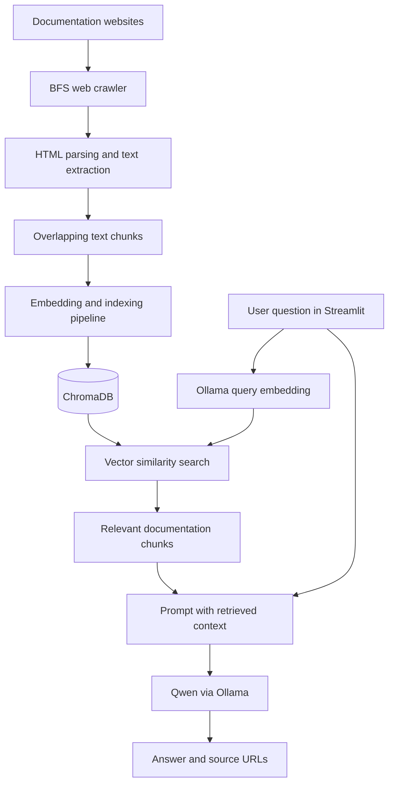

<div align="center">

# 🤖 DocuMind AI

### Documentation Question Answering with Retrieval-Augmented Generation (RAG)

**Ask questions about technical documentation and get context-aware answers with source links.**


</div>

---

## 📖 Overview

**DocuMind AI** is a Python-based documentation question-answering project that combines web crawling, text processing, vector search, and a locally hosted language model in a **Retrieval-Augmented Generation (RAG)** pipeline.

Instead of relying solely on a language model's internal knowledge, it retrieves relevant documentation passages from **ChromaDB** and includes them as context when generating responses with **Qwen via Ollama**. A **Streamlit** interface lets users ask questions and inspect source URLs.

> **Project status:** Work in progress. Some configuration, ingestion, and startup components are still being developed. See [Current Limitations](#-current-limitations).

## ✨ Features

- 📚 **Documentation crawling:** Breadth-first crawling of documentation websites with page and depth limits.
- 🧹 **HTML extraction:** Parse page titles and readable text from crawled pages.
- ✂️ **Text chunking:** Split long documents into overlapping chunks for retrieval.
- 🔎 **Semantic retrieval:** Search relevant passages stored in a persistent ChromaDB collection.
- 🧠 **RAG-based answering:** Supply retrieved passages to a Qwen model running locally with Ollama.
- 🔗 **Source attribution:** Display documentation URLs associated with retrieved passages.
- 🖥️ **Streamlit interface:** Ask questions through a simple web UI.
- ⚙️ **Centralized configuration:** Configure models, retrieval parameters, paths, and crawling limits through Pydantic Settings.

## 🏗️ Architecture



> **Note:** The repository contains separate components for crawling, chunking, embeddings, retrieval, and generation. The diagram shows the intended end-to-end workflow; the current repository does not yet provide a complete, documented ingestion command. Also, the standalone `EmbeddingGenerator` uses a Sentence Transformers model, while the retriever generates query embeddings through Ollama. Their vectors must be compatible and have matching dimensions for retrieval to work reliably.

## 🛠️ Tech Stack

| Component | Technology | Purpose |
|---|---|---|
| Language | Python | Core implementation |
| UI | Streamlit | Interactive question-answering interface |
| LLM | Qwen 2.5 via Ollama | Generate answers from retrieved context |
| Embeddings | Ollama (`all-minilm`) / Sentence Transformers (`BAAI/bge-small-en-v1.5`) | Vector representation of text |
| Vector store | ChromaDB | Persistent similarity search |
| Crawling | Beautiful Soup, lxml, HTTP fetching | Collect and parse web documentation |
| Configuration | Pydantic Settings | Environment-based configuration |

## 📁 Project Structure

```text
DocuMind-AI/
├── app.py                      # Streamlit application
├── backend/
│   ├── api.py                  # API placeholder
│   ├── core/
│   │   ├── config.py           # Settings and filesystem paths
│   │   └── logger.py           # Application logging
│   ├── crawler/
│   │   ├── crawler.py          # BFS documentation crawler
│   │   ├── fetcher.py          # Web page retrieval
│   │   └── parser.py           # HTML content extraction
│   ├── chunking/
│   │   └── chunker.py          # Overlapping text chunks
│   ├── embedding/
│   │   └── embedding.py        # Sentence Transformers embeddings
│   ├── retriever/
│   │   └── retriever.py        # ChromaDB semantic retrieval
│   ├── rag/
│   │   └── rag.py              # Retrieval and answer generation
│   └── llm/
│       └── ollama_client.py    # Placeholder
├── frontend/
│   └── app.py                  # Frontend placeholder
├── requirements.txt           # Currently empty
├── run.py                     # Currently empty
├── test_*.py                  # Component test / smoke-test scripts
└── README.md                  # Project documentation
```

The application also creates `data/raw/`, `data/processed/`, `logs/`, and `vectordb/` directories when its configuration loads.

## 🚀 Getting Started

### 1. Clone the repository

```bash
git clone https://github.com/sahellmokhtariii/DocuMind-AI.git
cd DocuMind-AI
```

### 2. Create a virtual environment

```bash
python -m venv .venv
```

Activate it:

**Windows (PowerShell):**

```powershell
.\.venv\Scripts\Activate.ps1
```

**macOS / Linux:**

```bash
source .venv/bin/activate
```

### 3. Install the required Python packages

The repository's `requirements.txt` is currently empty. Until it is populated, install the packages used by the checked-in modules:

```bash
pip install streamlit chromadb ollama pydantic-settings sentence-transformers beautifulsoup4 lxml requests
```

> This command is a best-effort dependency list based on the code, not a verified pinned environment. Additional dependencies may be required.

### 4. Install and prepare Ollama

Install [Ollama](https://ollama.com/) and start its local service. Then download the models referenced by the current code:

```bash
ollama pull qwen2.5:1.5b
ollama pull all-minilm
```

The RAG implementation directly uses `qwen2.5:1.5b`. Note that `backend/core/config.py` also declares `OLLAMA_MODEL=qwen2.5:7b`, but the RAG class does **not** currently use that setting.

### 5. (Optional) Create a `.env` file

Create a `.env` in the repository root to override supported settings:

```dotenv
APP_NAME="DocuMind AI"
OLLAMA_URL="http://localhost:11434"
OLLAMA_MODEL="qwen2.5:7b"
EMBEDDING_MODEL="all-minilm"
CHROMA_COLLECTION_NAME="documentation"
CHUNK_SIZE=800
CHUNK_OVERLAP=150
TOP_K=5
MAX_PAGES=300
MAX_DEPTH=2
```

**Important:** Some model identifiers and parameters are still hard-coded in individual modules, so not every setting above changes runtime behavior yet.

### 6. Prepare the vector database

The question-answering interface expects a ChromaDB collection named `documentation` containing document text and metadata, including `title` and `url`.

The repository includes crawling, chunking, and embedding modules, but **does not yet expose a verified one-command ingestion/indexing workflow**. The collection needs to be populated with embeddings **compatible with the query embeddings produced by Ollama's `all-minilm` model** before meaningful questions can be answered.

### 7. Start the app

```bash
streamlit run app.py
```

The app will open in your browser (usually at `http://localhost:8501`). It requires a running Ollama service and an initialized, populated ChromaDB collection for successful RAG results.

## 💬 Example Questions

The interface includes example prompts such as:

- How do I install Python?
- What is pip?
- How to create virtualenv?
- What is list comprehension?

These examples are most useful when the corresponding Python documentation has already been indexed.

## ⚙️ Key Configuration

| Setting | Default in `config.py` | Description |
|---|---|---|
| `OLLAMA_MODEL` | `qwen2.5:7b` | Configured LLM (currently overridden in the RAG class) |
| `OLLAMA_URL` | `http://localhost:11434` | Ollama server address |
| `EMBEDDING_MODEL` | `all-minilm` | Model used for retrieval query embeddings |
| `CHROMA_COLLECTION_NAME` | `documentation` | ChromaDB collection name |
| `CHUNK_SIZE` | `800` | Chunk length in characters |
| `CHUNK_OVERLAP` | `150` | Overlapping characters between chunks |
| `TOP_K` | `5` | Configured retrieval count (currently also hard-coded in the retriever method) |
| `MAX_PAGES` | `300` | Maximum crawled pages per crawl |
| `MAX_DEPTH` | `2` | Maximum crawling depth |

The configuration lists Python, NumPy, and scikit-learn documentation URLs. However, link extraction currently uses a hard-coded Python documentation URL prefix, so multi-site crawling requires further adjustments.

## 🧪 Tests and Smoke Checks

The repository includes standalone scripts to exercise components of the pipeline:

```bash
python test_config.py
python test_parser.py
python test_chunker.py
python test_retriever.py
python test_rag.py
```

Additional scripts test crawling, logging, and ChromaDB behavior. These are lightweight component checks rather than a documented automated test suite; some require a configured environment, running Ollama service, or populated database.

## ⚠️ Current Limitations

- `requirements.txt`, `run.py`, and some API/frontend helper modules are currently empty.
- There is no complete, documented command to crawl, embed, and insert all documents into ChromaDB.
- Document embeddings from Sentence Transformers and query embeddings from Ollama may be incompatible without aligning the indexing strategy.
- The application assumes the `RAG.ask()` result is a dictionary containing `answer` and `sources`; the no-results branch currently returns a string, which the UI does not handle.
- Some configuration values are not yet consistently used throughout the codebase.
- Crawling is currently restricted by a hard-coded Python documentation path prefix.

## 🗺️ Possible Next Steps

- [ ] Add a reproducible ingestion/indexing CLI.
- [ ] Standardize a single embedding model for indexing and retrieval.
- [ ] Populate and pin project dependencies in `requirements.txt`.
- [ ] Make the LLM model and retrieval parameters fully configurable.
- [ ] Handle empty retrieval results consistently in the UI.
- [ ] Support multiple documentation domains without hard-coded URL filtering.
- [ ] Add automated tests and deployment documentation.

## 🤝 Contributing

Contributions, suggestions, and bug reports are welcome. Open an issue or submit a pull request in the [GitHub repository](https://github.com/sahellmokhtariii/DocuMind-AI).

---

<div align="center">

**DocuMind AI — Turning documentation into searchable answers.**

</div>
